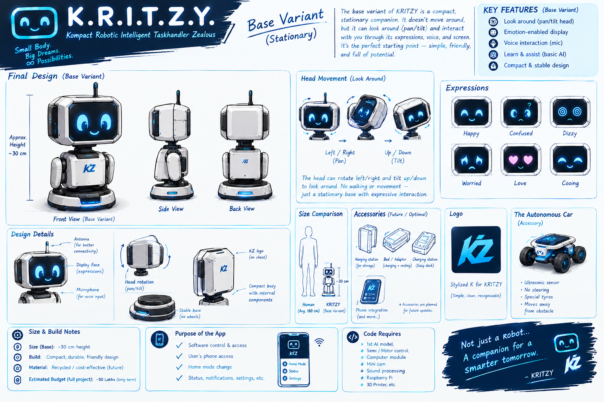

K.R.I.T.Z.Y. 🤖

A Compact Robotic Intelligent Companion

K.R.I.T.Z.Y. is a planned DIY robotics project focused on building a compact, interactive desk companion that can entertain, inform, and assist its user.

The vision is to create a friendly robot that stays on your desk, shares useful information, helps with study sessions, and brings a little personality to your workspace.

«Project Status: Early planning and prototyping. Features described in this README are planned goals and may change as development progresses.»

💡 What Does K.R.I.T.Z.Y. Stand For?

Kompact Robotically Intelligent Zealous Yapper

K.R.I.T.Z.Y. represents the idea of a compact robot that is always ready to interact, share information, and entertain.

🎯 Project Goals

The long-term vision includes:

- ⏱️ Study Companion: Timers and focus-session assistance.
- 🧠 Facts & Information: Sharing interesting facts and useful information.
- 💬 Interactive Personality: Friendly responses and engaging interactions.
- 🤖 Physical Expressions: Nodding and other simple movements.
- 🔧 DIY Robotics: An affordable, modular design built with accessible electronics.
- 📚 Learning Platform: A practical project for exploring embedded programming, electronics, sensors, and robotics.

🧰 Planned Hardware

The initial prototype may use the following components:

Component| Purpose
ESP32 DevKit V1| Main microcontroller
OLED display / LCD| Display information and expressions
Servo motor| Head movement or nodding
DC motors| Potential movement experiments
L298 motor driver| Motor control, if required
IR / PIR sensors| Detect nearby activity or presence
DIY chassis and wheels| Physical structure

The final hardware configuration is not fixed and will depend on testing, compatibility, and budget.

🧑‍💻 Software & Intelligence

The software is planned around ESP32 firmware and embedded programming.

Potential capabilities include:

- Timer and basic utility functions.
- Display-based expressions and status indicators.
- Sensor-driven interactions.
- Simple information and fact delivery.
- Optional connectivity for more advanced responses, if practical.

A key design goal is to make basic functions useful without depending entirely on cloud services. The final approach to offline operation, memory, and AI connectivity remains under exploration.

🗺️ Development Roadmap

- [ ] Finalize the first prototype's features.
- [ ] Prepare and verify the bill of materials.
- [ ] Test ESP32 input/output and display functionality.
- [ ] Implement a basic timer.
- [ ] Test servo movement and physical expressions.
- [ ] Experiment with sensors and interaction logic.
- [ ] Build and refine the physical chassis.
- [ ] Explore facts, information retrieval, and optional AI connectivity.
- [ ] Document wiring, code, experiments, and improvements.

This roadmap is flexible and will evolve as the project develops.

📂 Repository Structure

- "README.md" — Project overview, vision, and roadmap.
- "BOM.md" — Bill of materials and parts-funding information.
- "JOURNAL.md" — Development log and project progress.

Note: "BOM.md" and "JOURNAL.md" are mirrored from "Hack Club Half Life" (https://halflife.hackclub.com). Direct edits to those mirrored files may be overwritten during synchronization.

💰 Budget & Build Philosophy

K.R.I.T.Z.Y. is intended to be developed incrementally, prioritizing affordable components and testing each subsystem before adding complexity.

The overall budget is not finalized. Costs will depend on the selected hardware, mechanical design, and future upgrades.

🤝 Feedback & Contributions

K.R.I.T.Z.Y. is an evolving maker project.

Ideas, suggestions, and technical feedback are welcome through GitHub Issues. Helpful suggestions should explain the proposed feature, required hardware, and any relevant cost or power constraints.

📄 License

No license has been specified yet. Until a license is added, please contact the repository owner before reusing or redistributing project materials.

KRITZY Base Variant — Concept Art

"KRITZY Base Variant Concept Art"

The base variant is designed as a stationary, expressive companion robot. It has no locomotion system; instead, its head is intended to rotate left and right and tilt up and down to look around.

Status: Concept design only. Mechanical implementation and hardware specifications are still under development.
